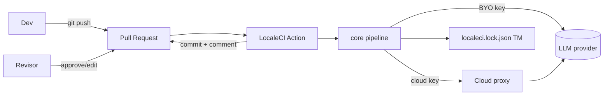
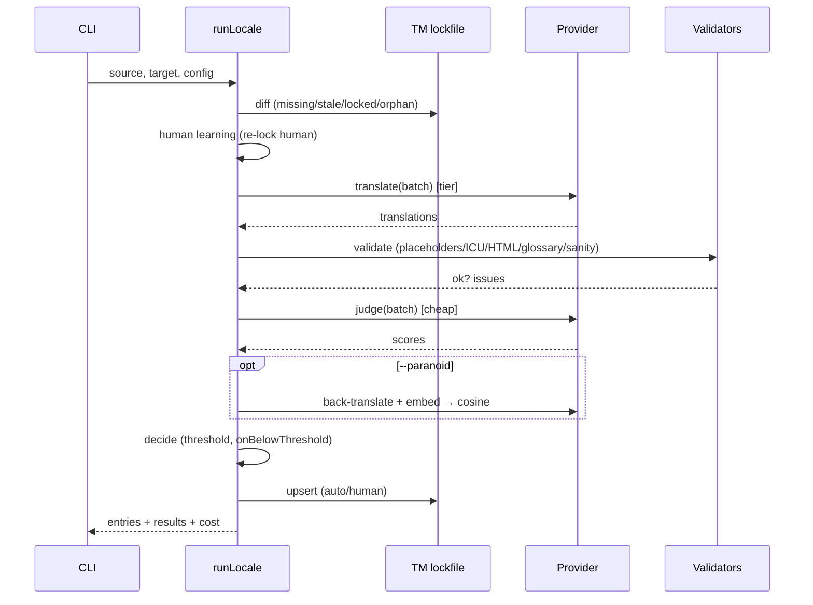
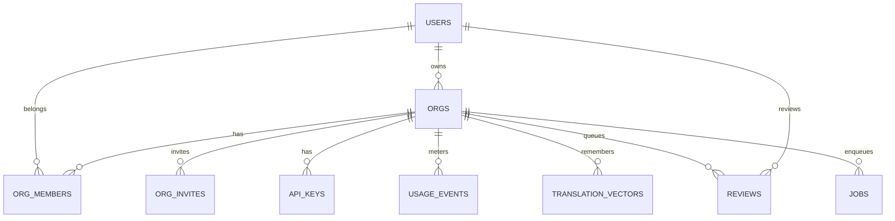
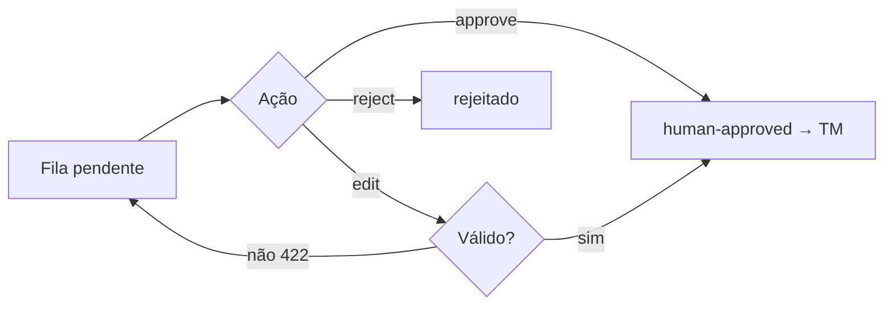
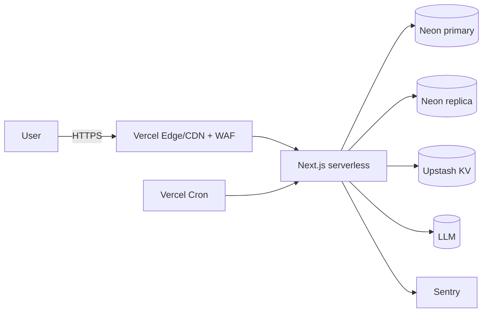
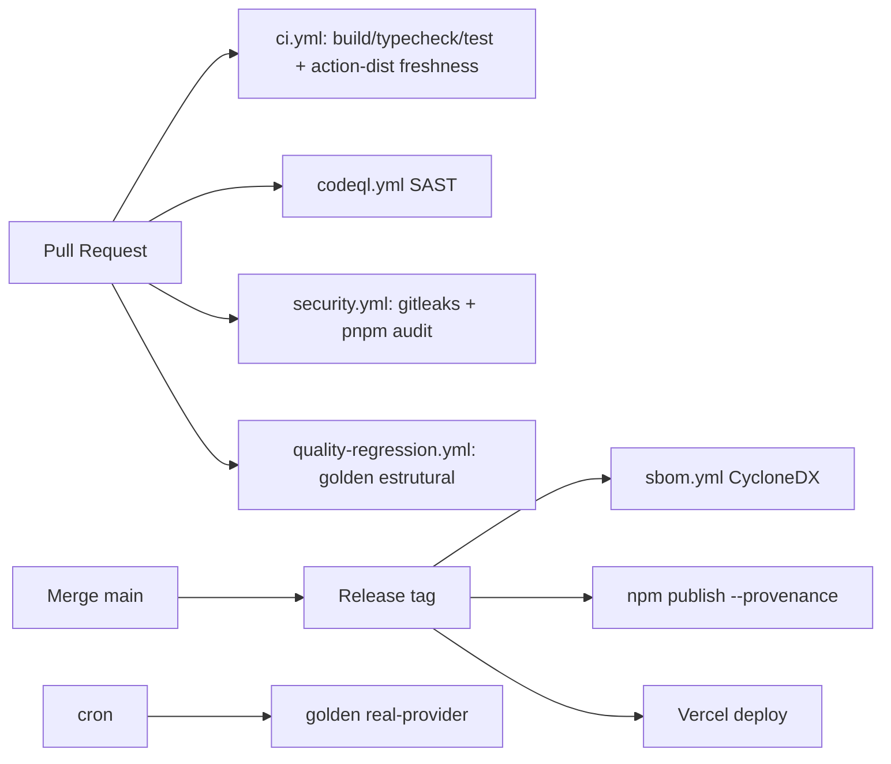

# LocaleCI — Documentação de Engenharia (Enterprise)

> **Fonte da verdade:** o código deste monorepo. Esta documentação foi derivada
> do sistema implementado (v0.5.x, 314 testes verdes). Termos técnicos e
> identificadores permanecem em inglês; a narrativa é em português.
>
> **Status de maturidade:** núcleo OSS pronto para produção; camada cloud
> implementada com lógica testada + adaptadores de deploy prontos (pendente
> apenas provisionamento). Ver §21 (Premissas & Lacunas).

## Índice

1. Visão Geral · 2. Requisitos Funcionais · 3. Requisitos Não Funcionais ·
4. Arquitetura · 5. Modelagem de Dados · 6. APIs · 7. Banco de Dados ·
8. Front-end · 9. Backend · 10. Infraestrutura · 11. DevOps · 12. Segurança ·
13. IA · 14. Observabilidade · 15. Testes · 16. Roadmap · 17. Backlog ·
18. Riscos · 19. Custos · 20. Melhorias · 21. Premissas & Lacunas ·
22. Checklists

---

## 1. Visão Geral

### 1.1 Objetivo do sistema
LocaleCI é uma plataforma **Git-native** de localização (i18n) que traduz os
arquivos de mensagens de um app com LLMs **a cada commit**, atribuindo a **cada
string um score de qualidade auditável (0–100)**. O produto é o *pipeline de
qualidade*, não a tradução em si.

### 1.2 Problema resolvido
Times de SaaS pequenos/médios não localizam porque as opções são ruins:
- **TMS** (Lokalise/Crowdin/Phrase): US$ 120–1.200/mês, semanas de setup, strings
  na plataforma de terceiros, workflow feito para tradutores, não para CI.
- **Script GPT caseiro**: quebra plurais ICU, perde placeholders, sem memória de
  tradução, sem glossário, ninguém confia em produção.

LocaleCI é a terceira opção: **tradução como build step** — Git é a fonte da
verdade, cada string recebe um score verificável, e a revisão acontece no PR.

### 1.3 Público-alvo & Personas
| Persona | Papel | Dores | Como o produto ajuda |
|---|---|---|---|
| **Dev full-stack (indie/SaaS)** | Instala e mantém i18n | Não quer TMS caro nem script frágil | `npx localeci`, Action no PR, custo próximo de zero |
| **Tech Lead** | Aprova qualidade | Não confia em tradução por IA | Score por string + validadores determinísticos + review no PR |
| **Product/Growth** | Quer novos mercados | 60–75% do TAM fala outra língua | Localização barata e rápida |
| **Revisor/Tradutor** | Corrige flagged | Contexto ausente | Contexto do componente + review colaborativo web |
| **Org Admin (cloud)** | Gerencia time/billing | RBAC, cotas, compliance | Membros/RBAC, planos, DSAR, audit log |

### 1.4 Benefícios & Diferenciais
- **Diff mínimo (regra de ouro):** serializers preservam ordem/indentação/
  comentários — o PR só mostra as strings novas/alteradas.
- **Validadores determinísticos** (placeholders, ICU/CLDR, HTML, glossário,
  sanidade) rodam *antes* do LLM-judge — quebra estrutural nunca chega ao repo.
- **Translation Memory como lockfile** versionado no Git → idempotente, $0 no
  caso comum, dados do cliente (anti-lock-in).
- **10 formatos**, **contexto por AST** (React/Vue/Svelte), **back-translation por
  embeddings**, **retrieval semântico (pgvector)**, **aprendizado humano**.

### 1.5 Casos de uso (resumo)
UC-01 Onboarding (`init`) · UC-02 Traduzir faltantes (`translate`) · UC-03
Validar em CI (`check`) · UC-04 Cobertura (`status`) · UC-05 Traduzir no PR
(Action) · UC-06 Revisar no PR/web · UC-07 Proxy metered (cloud) · UC-08
Playground · UC-09 DSAR/exclusão · UC-10 Export de dataset fine-tuning.



---

## 2. Requisitos Funcionais

| ID | Nome | Descrição | Entradas | Saídas | Regras de negócio | Prio | Depende |
|---|---|---|---|---|---|---|---|
| RF-01 | Detectar setup i18n | `init` detecta lib (i18next/next-intl/vue-i18n/svelte-i18n), pasta, formato e locale-fonte | cwd, package.json, pasta locales | `localeci.config.json` + glossário seed | Escolhe locale mais completo; extensão→formato | Must | — |
| RF-02 | Traduzir faltantes/mudadas | `translate` compara fonte×lock×alvo e traduz `missing`/`stale` | config, arquivos, lock | arquivos alvo + lock atualizados | String em lock não vai ao LLM; `human` imutável | Must | RF-01 |
| RF-03 | Validação determinística | 5 validadores antes do judge | source, target, locale, glossário | ok + issues | Falha ⇒ score 0, não escreve | Must | RF-02 |
| RF-04 | Score de qualidade | LLM-judge (0–5×4) → 0–100; opcional back-translation | source, target, contexto | score, decisão | `flag`/`fail`/`skip` por threshold | Must | RF-03 |
| RF-05 | Translation Memory | Lockfile hash sha256(srcLocale\|key\|src\|tgt) | — | `localeci.lock.json` | Ordenado, diffs limpos; `human` protegido | Must | RF-02 |
| RF-06 | Glossário | Termos never-translate/mapeados no prompt e validados | glossário JSON | issues | Prompt não garante ⇒ validar | Should | RF-03 |
| RF-07 | Contexto | Namespace, vizinhos, comentários + scan de código (AST/grep) | arquivos de código | ContextBundle | AST se TS disponível; fallback grep | Should | RF-02 |
| RF-08 | ICU por-braço | Plural/select traduzidos por braço com categorias CLDR do alvo | string ICU | ICU recomposto | pl exige `few`; ja só `other` | Must | RF-03 |
| RF-09 | `check` (CI) | Valida sem traduzir; exit≠0 em missing/broken/low/store-limit | config, arquivos, lock | relatório + exit code | strict opcional; `--json` | Must | RF-03 |
| RF-10 | `status` | Cobertura por locale | config, arquivos | tabela | — | Should | RF-09 |
| RF-11 | Roteamento de modelos | Classificador determinístico tier cheap/top | key, texto, locale | tier | >80c, ICU, HTML, marketing, low-resource ⇒ top | Should | RF-02 |
| RF-12 | Back-translation `--paranoid` | Traduz de volta; similaridade (embeddings/tokens) modula score | target | score ajustado | Peso 0.35; embeddings se provider suporta | Could | RF-04 |
| RF-13 | Aprendizado humano | Edição humana no PR ⇒ re-lock `human` + few-shot | fonte, alvo, lock | lock + exemplos | Detecta target≠lock com fonte igual | Should | RF-05 |
| RF-14 | Formatos | JSON/i18next/next-intl, YAML, PO, iOS .strings, Android XML, Fluent, Markdown, texto | arquivo | FlatEntry[] | Regra de ouro do diff | Must | — |
| RF-15 | GitHub Action | Traduz no PR, commita `[skip-localeci]`, upsert 1 comentário | evento PR, inputs | commit + comment + outputs | Fork ⇒ read-only `check` | Must | RF-02 |
| RF-16 | Emissão de API key | Cloud emite `lcx_live_…`, hash argon2/scrypt, mostrada 1x | sessão, orgId | secret (1x) + prefix | admin+; auditado | Must | RF-19 |
| RF-17 | Proxy metered | `/translate` chama provider com chaves da plataforma, mede uso, aplica limites | batch, Bearer key | tradução + uso | Zero-retention; cota de plano | Must | RF-16 |
| RF-18 | Planos & billing | Free/Pro/Team/Scale via Stripe | webhook | plano do org | `planForPriceId` fonte única | Should | RF-17 |
| RF-19 | Auth & Org | GitHub OAuth; org por usuário; RBAC (owner/admin/member) | OAuth | sessão + org | Deny-by-default | Must | — |
| RF-20 | Revisão colaborativa | approve/edit/reject validado; alimenta TM | ação, sessão | decisão + TM | Edit quebrado ⇒ 422 | Should | RF-19 |
| RF-21 | Preview visual UI | Detecta overflow por elemento | strings, locale | verdicts | Scale tier | Could | RF-17 |
| RF-22 | Playground | Traduz 1 string ao vivo com pipeline | source, locales | tradução+score | Público, rate-limit + budget cap | Should | RF-04 |
| RF-23 | TM semântica | pgvector kNN sugere aprovadas como few-shot | vetor, locale | matches | minScore 0.6 | Could | RF-13 |
| RF-24 | Fine-tuning | `dataset` exporta JSONL; roteia locale→modelo FT | lock | JSONL + readiness | Gate 50M strings | Could | RF-05 |
| RF-25 | Fila persistente | Enfileira sob carga; workers com retry/backoff | job | resultado | FOR UPDATE SKIP LOCKED | Could | RF-17 |
| RF-26 | LGPD (DSAR/erasure/audit/retention) | Export, exclusão, audit hash-chained, retenção | sessão | bundle/plan | Audit retido; transfere ownership | Must | RF-19 |
| RF-27 | MFA (TOTP) | Enroll/verify RFC 6238 | sessão, código | secret/enabled | Habilita só após verificar | Should | RF-19 |

---

## 3. Requisitos Não Funcionais

| Categoria | Requisito / Meta |
|---|---|
| **Performance** | `translate` 200 strings×5 locales < 90s (paralelismo 4); no-op (tudo no lock) < 2s e $0; API p95 < 1.2s (translate), p99 < 2.5s |
| **Escalabilidade** | Core stateless; cloud serverless (Vercel); TM cache KV; read replica; pgvector HNSW; fila para picos (>50 req/min) |
| **Disponibilidade** | Alvo 99.9% (Pro), SLA Scale; multi-AZ via Vercel/Neon (multi-region futura) |
| **Segurança** | OWASP ASVS L2, Top 10 mitigado; deny-by-default authz; rate limiting; CSRF/CSP/HSTS; MFA; scrypt/argon2; DevSecOps no CI |
| **Observabilidade** | Logs estruturados (Pino) com redaction; Sentry; métricas/alertas de custo LLM por org; OpenTelemetry (planejado) |
| **Auditoria** | `audit_log` imutável hash-chained; ações sensíveis registradas; `verifyChain` |
| **LGPD** | Zero-retention default; DSAR export/erasure; retenção configurável; base legal documentada |
| **PCI** | Fora de escopo — pagamentos delegados ao **Stripe** (SAQ-A); nenhum dado de cartão trafega/armazena no sistema |
| **ISO 27001** | Controles de acesso (RBAC), gestão de chaves, log de auditoria, gestão de vulnerabilidades (Dependabot/SCA), SDLC seguro |
| **OWASP ASVS/Top 10** | Ver §12 (mapeamento completo) |
| **Resiliência** | Retry exponencial (provider e fila), circuit breaker de custo, fallback grep (AST), fallback token-sim (embeddings) |
| **Backup** | Neon PITR (retenção ≥ 7 dias); lockfile é backup natural da TM (no Git do cliente) |
| **Disaster Recovery** | **RTO 4h · RPO 1h** (metas). Runbook + restore de branch Neon; IaC futura para reprovisionamento |
| **SLA/SLO/SLI** | **SLA** 99.9% (planos pagos). **SLOs:** disponibilidade 99.9%, p95 translate < 1.2s, taxa de erro 5xx < 0.5%. **SLIs:** `http_req_duration`, `http_req_failed`, cost/org, quota alerts |

---

## 4. Arquitetura

### 4.1 Estilo & Justificativa
**Modular Monolith no núcleo (packages) + Serverless na cloud (Next.js/Vercel).**
Escolha:
- Núcleo é uma biblioteca pura (filesystem-free, network-free) com **portas &
  adaptadores (Hexagonal)**: `Parser` e `Provider` são as portas; JSON/YAML/PO/…
  e Anthropic/OpenAI/mock/cloud são adaptadores. Facilita testes (mock) e extensão.
- Cloud é serverless por custo (escala a zero) e simplicidade operacional (sem
  K8s). Rotas Next são **adaptadores finos** sobre *handlers* injetáveis testados
  (Clean Architecture: caso-de-uso no `lib/`, I/O na borda).
- **Event/Job-driven** apenas onde necessário (fila de tradução sob carga).

### 4.2 Padrões aplicados
| Padrão | Onde |
|---|---|
| Hexagonal (Ports & Adapters) | `Parser`, `Provider`, `SemanticMemory`, `Cache`, `RateLimiter`, `AuditLog`, `MembershipStore` |
| Clean Architecture | `lib/handlers/*` (casos de uso) ↔ rotas (borda) ↔ `server/*` (infra) |
| DDD (tático leve) | Entidades: Org, User, ApiKey, UsageEvent, Review, Invite, Job, AuditEvent |
| CQRS (leve) | Leituras de dashboard/usage → read replica; escritas → primary |
| Strategy | Roteamento de modelos (tier), escolha de provider |
| Pipeline | `parse→diff→context→batch→translate→validate→judge→score→decide` |
| Circuit Breaker | Budget cap de custo LLM (playground/org) |

### 4.3 Diagrama de containers (C4 nível 2)

```mermaid
flowchart TB
  subgraph Client
    CLI[localeci CLI]
    GA[GitHub Action]
  end
  subgraph Core[packages]
    CORE[@localeci/core\nparsers/pipeline/validators]
    PROV[@localeci/providers\nanthropic/openai/cloud/mock]
  end
  subgraph Cloud[apps/cloud - Vercel]
    MW[middleware\nCSP+CSRF]
    API[API routes /api/v1/*]
    HAND[lib/handlers\ncasos de uso]
    AUTH[Auth.js GitHub]
  end
  DB[(Neon Postgres\n+ pgvector)]
  KV[(Upstash KV)]
  SENTRY[(Sentry)]
  STRIPE[(Stripe)]
  LLM[(Anthropic/OpenAI)]

  CLI --> CORE --> PROV
  GA --> CORE
  PROV -->|BYO| LLM
  PROV -->|cloud| API
  MW --> API --> HAND
  HAND --> DB
  HAND --> KV
  HAND --> PROV
  API --> SENTRY
  API --> STRIPE
  AUTH --> DB
```

### 4.4 Fluxo do pipeline de tradução (sequência)



---

## 5. Modelagem de Dados

### 5.1 Modelo conceitual (MER)



### 5.2 Modelo lógico/físico (Drizzle → Postgres)
| Tabela | Campos-chave | Tipos | Índices | Constraints |
|---|---|---|---|---|
| `users` | id(PK), github_id(UQ), email, name, mfa_secret, mfa_enabled_at, created_at | text/timestamp | uq(github_id) | NOT NULL id/github_id/email |
| `orgs` | id(PK), name, owner_id(FK users), plan(enum), stripe_customer_id, stripe_sub_id | text/enum | — | FK owner_id |
| `org_members` | id(PK), org_id(FK), user_id(FK), role(enum) | text/enum | uq(org_id,user_id) | RBAC |
| `org_invites` | id(PK), org_id(FK), email, role, token(UQ), status(enum), expires_at | text/timestamp | idx(org_id,email) | uq(token) |
| `api_keys` | id(PK), org_id(FK), hash, prefix, last_used_at, revoked_at | text/timestamp | idx(prefix) | hash argon2/scrypt |
| `usage_events` | id(PK), org_id(FK), period, strings_translated, tokens_in/out, model, locale, content_hash? | text/int/bigint | idx(org_id,period) | **sem coluna de texto** (zero-retention) |
| `translation_vectors` | id(PK), org_id(FK), locale, source, target, embedding(vector 1536) | vector | uq(org,locale,source), hnsw(vector_cosine_ops) | pgvector |
| `reviews` | id(PK), org_id(FK), batch, key, locale, source, machine_target, score, status(enum), final_target, reviewer_id | text/enum | idx(org,batch,status) | — |
| `jobs` | id(PK), org_id?, kind, payload(jsonb), status(enum), attempts, max_attempts, next_run_at, lease_until | jsonb/timestamp | idx(status,next_run_at) | FOR UPDATE SKIP LOCKED |
| `audit_log` | seq(PK), actor_id, org_id, action, target, at, meta(jsonb), prev_hash, hash | text/jsonb | idx(org_id,seq) | **imutável, hash-chained** |

**Views/Procedures/Triggers:** o design é *application-driven* (Drizzle);
não há triggers/procedures — a integridade da cadeia de auditoria é garantida no
`DbAuditLog` (transação + lock da tail). **View sugerida:** `org_usage_current`
(agregação de `usage_events` por org/período) para o dashboard. **Trigger
sugerida (opcional):** `audit_log` `BEFORE UPDATE/DELETE → RAISE` para reforçar
imutabilidade no nível do banco.

---

## 6. APIs

Todas as rotas versionadas em `/api/v1/*`. Autorização deny-by-default; rate
limiting por classe; respostas JSON. Ver `docs/openapi.yaml` para o contrato
OpenAPI 3.1 completo.

| Método | URL | Auth | Rate class | Descrição |
|---|---|---|---|---|
| POST | `/api/v1/translate` | Bearer API key | translate (120/min) | Proxy metered de tradução |
| POST | `/api/v1/judge` | Bearer API key | translate | Judge de qualidade |
| POST | `/api/v1/keys` | Session (admin+) | write (60/min) | Emite API key (1x) |
| POST | `/api/v1/playground` | Público | public (10/min) + budget cap | Traduz 1 string ao vivo |
| POST | `/api/v1/preview` | Bearer (Scale) | translate | Overflow de UI |
| POST | `/api/v1/reviews/:id` | Session (org member) | write | approve/edit/reject |
| GET/POST | `/api/v1/orgs/:id/members` | Session (member/admin) | write | Lista/convida membros |
| POST | `/api/v1/mfa` | Session | auth (20/min) | enroll/verify TOTP |
| POST | `/api/v1/privacy/export` | Session | write | DSAR export |
| POST | `/api/v1/privacy/delete` | Session | write | Erasure |
| POST | `/api/worker` | `Bearer WORKER_SECRET` | — | Drena fila (cron) |
| POST | `/api/retention` | `Bearer WORKER_SECRET` | — | Enforce retenção (cron) |
| POST | `/api/stripe/webhook` | Assinatura Stripe | — | Sync de plano |
| GET/POST | `/api/auth/[...nextauth]` | — | auth | OAuth GitHub |

**Exemplo — `POST /api/v1/translate`**
```jsonc
// Request (Bearer lcx_live_…)
{ "sourceLocale":"en","targetLocale":"de","tier":"cheap",
  "items":[{"id":"nav.save","text":"Save changes"}],
  "style":{"tone":"professional","audience":"SaaS UI","notes":""},"glossary":[] }
// 200
{ "translations":[{"id":"nav.save","text":"Änderungen speichern"}],
  "model":"claude-haiku-4-5","tokensIn":120,"tokensOut":40 }
// Erros: 401 (sem/inv. key), 402 (cota/limite), 429 (rate), 502 (upstream)
```
**Versionamento:** path-based (`/v1`). Mudanças breaking ⇒ `/v2` com deprecation
policy (6 meses, header `Sunset`). **Idempotência:** `translate` é idempotente
via TM/cache (mesma entrada ⇒ mesmo resultado, $0 no cache hit).

---

## 7. Banco de Dados

- **Engine:** PostgreSQL (Neon serverless) + extensão `vector` (pgvector).
- **ORM/migrations:** Drizzle + drizzle-kit (`pnpm db:generate` → SQL versionado
  em `drizzle/`; `pnpm db:migrate`). **Estratégia:** migrations forward-only,
  revisadas em PR; `CREATE EXTENSION vector` uma vez.
- **Chaves:** PKs textuais cuid2; FKs explícitas; UQs em (org,locale,source),
  (org,user), github_id, token, prefix (índice).
- **Retenção:** usage 400d, reviews 180d, audit 730d, TM do cliente = ilimitada.
- **Read scaling:** `dbRead` (replica) para leituras de dashboard/usage.

---

## 8. Front-end

> A UI web é uma **implementação de referência** (Next.js App Router). A
> experiência principal do produto é a **CLI** (madura). Recomenda-se, para
> produção, adotar um Design System (ver §20).

### 8.1 Telas
| Tela | Rota | Componentes | Estados |
|---|---|---|---|
| Landing | `/` | hero, código, pricing, FAQ | — |
| Dashboard | `/dashboard` | uso do mês, barra de cota, gerar key, upgrade | loading/empty/erro |
| Preview visual | `/dashboard/preview` | cards fit/tight/overflow por elemento | — |
| Review queue | `/dashboard/reviews` | lista + approve/edit/reject | vazio 🎉 |
| Playground | `/playground` | textarea, seletor locale, resultado+score | loading, throttled(429) |

### 8.2 UX/UI/Acessibilidade (estado atual & metas)
- **CLI (nota alta):** `init` mágico, cores por score, exit codes, `--json`, `--mock`.
- **Web (a evoluir):** hoje usa estilos inline sem Design System, responsividade
  mínima e **acessibilidade insuficiente** (faltam labels/aria, foco visível,
  verificação de contraste). **Meta:** WCAG 2.1 AA, tokens, dark/light.
- **Mensagens/validações:** erros de config apontam o campo (Zod); no web,
  formulários devem exibir erros inline + toasts.

### 8.3 Fluxo de review (web)


---

## 9. Backend

### 9.1 Camadas (cloud)
```
middleware.ts            → CSP/HSTS/CSRF, headers
app/api/**/route.ts      → adaptadores finos (HTTP ↔ deps)
lib/handlers/*           → casos de uso (DI, testados)
lib/*                    → domínio puro (authz, plans, review, privacy, totp, cache…)
server/*                 → infra (Drizzle stores, redis, sentry sink, audit)
db/*                     → schema + clients (primary/replica)
```
### 9.2 Serviços/Repositories/Controllers/Middlewares
- **Controllers:** route handlers (thin).
- **Use cases:** `handleReviewAction`, `handleMemberInvite`, `handleKeyCreation`,
  `handlePrivacyExport/Deletion`, `handleMfa`, `handleTranslate/Judge`.
- **Repositories (portas):** `ReviewStore`, `MemberStore`, `KeyStore`,
  `OrgLookup`, `MfaUserStore`, `UsageStore`, `SemanticMemory`, `MembershipStore`,
  `AuditLog`, `SpendStore`, `Cache`, `RateLimiter`.
- **Middlewares:** segurança (headers/CSRF) + rate limit por rota (`enforceRateLimit`).
### 9.3 Workers/Jobs/Cache/Fila/Mensageria
- **Fila:** `jobs` table + `DbJobQueue` (FOR UPDATE SKIP LOCKED) + `processJobs`
  (retry exponencial 1s/5s/25s, cap 5m). Cron `/api/worker` a cada 1 min.
- **Cache:** `InMemoryLru`/`KvCache` (TM quente) via `withCache(provider)`.
- **Cron:** `/api/retention` (03:00), `/api/worker` (1 min).
- **Mensageria:** não há broker dedicado (fila em Postgres é suficiente até
  gatilho de escala; ver §16).

---

## 10. Infraestrutura

| Item | Escolha | Notas |
|---|---|---|
| Cloud | **Vercel** (app + cron) | serverless, escala a zero |
| Banco | **Neon** Postgres + pgvector | branch/PITR; read replica |
| KV/Cache | **Upstash** Redis | rate limit + TM cache distribuídos |
| Erros | **Sentry** | com redaction (sem conteúdo do cliente) |
| Email | **Resend** | transacional (convites) |
| Pagamentos | **Stripe** Checkout + Portal | PCI SAQ-A |
| Containers/K8s | **N/A** | serverless por escolha; equivalentes: edge config, secrets Vercel |
| CDN | Vercel Edge (default) | + CDN para assets estáticos |
| Storage | — | sem blobs; strings ficam no Git do cliente |
| Secrets | Vercel Env Vars | rotação manual; futura: vault |
| IAM/Rede/DNS | Vercel/Neon gerenciados | DNS do domínio; TLS gerenciado |
| Firewall/WAF | Vercel + rate limit app-layer | WAF gerenciado (Vercel) |
| IaC | **Ausente** (gap) | recomendação: Terraform (§20) |



---

## 11. DevOps

### 11.1 CI/CD

### 11.2 Git Flow & Branches
- Trunk-based: `main` protegida; branches `feat/*`, `fix/*`, `docs/*`; PR com CI
  verde + CODEOWNERS; squash-merge.
### 11.3 Testes automáticos
- 314 testes (Vitest) offline (mock); golden regression; SCA gate.
### 11.4 Deploy/Rollback/Flags/Blue-Green/Canary
- **Deploy:** Vercel (preview por PR, prod no merge). **Rollback:** promover
  deployment anterior (imutável) na Vercel. **Feature flags:** via env/plan
  (`org.plan`, `context.ast`, `quality.paranoid`). **Canary/Blue-Green:** Vercel
  traffic split (recomendado para mudanças de prompt/modelo, junto do golden).

---

## 12. Segurança

### 12.1 OWASP Top 10 (2021) — estado atual
| # | Categoria | Status | Evidência |
|---|---|---|---|
| A01 Broken Access Control | ✅ Mitigado | `requireOrgAccess` deny-by-default + RBAC em todas as rotas |
| A02 Cryptographic Failures | ✅/🟡 | scrypt async (argon2id recomendado); TLS gerenciado; sem segredos em log (redaction) |
| A03 Injection | ✅ | Drizzle parametrizado; prompt-injection tratado como dado |
| A04 Insecure Design | ✅ | playground com rate limit + budget cap; threat model (STRIDE) |
| A05 Security Misconfiguration | ✅ | CSP/HSTS/X-Frame/nosniff via middleware |
| A06 Vulnerable Components | ✅ | Dependabot + `pnpm audit` gate (undici corrigido) + SBOM |
| A07 Auth Failures | ✅/🟡 | GitHub OAuth + MFA TOTP; rate limit em auth; sem senha própria |
| A08 Integrity Failures | ✅ | npm provenance; audit log hash-chained; SBOM |
| A09 Logging Failures | ✅ | logger estruturado + Sentry + alertas de custo |
| A10 SSRF | ✅ | sem fetch de URL do usuário |

### 12.2 OWASP API Top 10 (destaques)
API1 BOLA ✅ (org check); API2 Broken Auth ✅ (Bearer+session+MFA); API4 Resource
Consumption ✅ (rate limit + budget cap + cota de plano); API5 BFLA ✅ (RBAC
roles); API8 Misconfig ✅ (headers).

### 12.3 STRIDE (threat model resumido)
| Ameaça | Vetor | Mitigação |
|---|---|---|
| **S**poofing | Roubo de API key | hash argon2/scrypt, prefix, revogável, timing-safe |
| **T**ampering | Editar audit log | hash-chain + `verifyChain` + (trigger opcional) |
| **R**epudiation | Negar ação | audit log imutável por ator |
| **I**nfo Disclosure | Vazar strings/PII | zero-retention, redaction, DSAR |
| **D**oS | Abuso do playground | rate limit + circuit breaker de custo |
| **E**levation | Acesso cross-org | deny-by-default + RBAC + last-owner protection |

### 12.4 DREAD (top riscos priorizados)
| Risco | D | R | E | A | D | Score | Severidade |
|---|---|---|---|---|---|---|---|
| Financial-exhaustion (playground) | 8 | 7 | 9 | 8 | 6 | 7.6 | Alta → **mitigado** |
| BOLA cross-org | 9 | 6 | 7 | 9 | 5 | 7.2 | Alta → **mitigado** |
| Vazamento de PII em strings | 8 | 4 | 5 | 8 | 6 | 6.2 | Média (zero-retention) |
| Prompt injection | 6 | 5 | 4 | 6 | 5 | 5.2 | Média (dado-only + validador) |

### 12.5 LINDDUN (privacidade)
Linkability/Identifiability ⇒ pseudonimização (audit actor); Non-repudiation ⇒
audit; Detectability ⇒ minimização; **D**isclosure ⇒ zero-retention/redaction;
Unawareness ⇒ política de privacidade + DSAR; Non-compliance ⇒ retenção +
base legal.

### 12.6 Frameworks & Ferramentas
NIST CSF (Identify/Protect/Detect/Respond/Recover) parcialmente coberto; CIS
Controls (inventário deps/SBOM, MFA, log); ISO 27001 controles A.9/A.12/A.14.
**Ferramentas:** CodeQL (SAST), gitleaks (secrets), `pnpm audit`/Snyk (SCA),
CycloneDX (SBOM), OWASP ZAP (DAST — recomendado), Trivy (container/IaC — quando
houver IaC).

---

## 13. IA

### 13.1 Modelos & pipeline
- **LLMs:** Anthropic (haiku/sonnet), OpenAI (gpt-4o/mini) atrás de `Provider`.
- **Embeddings:** OpenAI `text-embedding-3-small` (1536d); mock hashing-vector
  offline.
- **Vector DB:** pgvector (HNSW, cosine) — TM semântica por org.
- **RAG (leve):** retrieval de traduções aprovadas como few-shot (§RF-23).
- **Prompt Engineering:** prompt central versionado (`buildTranslatePrompt`),
  regras de placeholders/ICU/glossário; golden set gate mudanças de prompt.

### 13.2 OWASP LLM Top 10 (2025) — mapeamento
| # | Risco | Mitigação no LocaleCI |
|---|---|---|
| LLM01 Prompt Injection | Conteúdo do cliente como **dado JSON**, nunca instrução; instrução explícita de ignorar; validador de sanidade pega vazamento (“Here is the translation…”) |
| LLM02 Insecure Output | Saída parseada com **Zod** + validadores determinísticos antes de escrever |
| LLM03 Data Poisoning | TM/aprendizado só de traduções **human-approved**; edições validadas |
| LLM04 Model DoS | Rate limit + budget cap + batching + concorrência limitada |
| LLM05 Supply Chain | Providers atrás de interface; SBOM; deps pinadas |
| LLM06 Sensitive Info | Zero-retention; redaction; sem envio de segredos |
| LLM07 Insecure Plugin | Sem plugins/tools arbitrárias no caminho de produção |
| LLM08 Excessive Agency | Sem agentes autônomos; human-in-the-loop no review |
| LLM09 Overreliance | **Score por string** + validadores + review no PR (o produto é a confiança verificável) |
| LLM10 Model Theft | Chaves da plataforma server-side; proxy zero-retention |

### 13.3 Guardrails / Output validation / HITL
Guardrails determinísticos (placeholders/ICU/HTML/glossário/sanidade) +
back-translation (embeddings) + judge + **human-in-the-loop** (flagged → review).
MITRE ATLAS: mitigações contra *LLM Prompt Injection* e *Poisoning* conforme acima.

---

## 14. Observabilidade

- **Logs:** `createLogger` (JSON estruturado, `requestId`/`orgId`, **redaction**
  de conteúdo/segredos) → stdout → Vercel/Loki/Datadog.
- **Erros:** `sentrySink` encaminha error/warn ao Sentry.
- **Métricas/Alertas:** custo LLM e taxa de erro **por org** (`costAlertLevel`:
  warning ≥80%, critical ≥100% da cota).
- **Tracing:** OpenTelemetry (planejado) → Tempo/Honeycomb.
- **Dashboards:** uso/custo por org, p95/p99, taxa de flagged, cache hit ratio.
- **Health check:** `GET /` (readiness); recomendação: `/api/health` dedicado.

---

## 15. Testes

| Tipo | Estado | Ferramenta |
|---|---|---|
| Unitários | ✅ 314 | Vitest |
| Integração (handlers, e2e pipeline) | ✅ (fakes in-memory + mock provider) | Vitest |
| E2E CLI | ✅ (tmp dirs) | Vitest |
| Golden/regressão de qualidade | ✅ estrutural (mock) + noturno real | harness próprio |
| Carga/Stress | ✅ scripts | k6 (`load/*.k6.js`, SLOs p95/p99) |
| Segurança SAST | ✅ | CodeQL |
| SCA | ✅ gate | pnpm audit / Snyk |
| Secret scan | ✅ | gitleaks |
| SBOM | ✅ | CycloneDX |
| DAST | 🟡 recomendado | OWASP ZAP |
| IAST/Container/IaC scan | 🟡 quando houver IaC/containers | Trivy |
| Cobertura | Meta ≥ 85% no `lib/`/core | c8/vitest coverage |
| Chaos | 🟡 planejado | falhas de provider/DB injetadas |

---

## 16. Roadmap

| Fase | Escopo |
|---|---|
| **MVP** (feito) | CLI (init/translate/check/status), 3 formatos, pipeline de qualidade, TM lockfile, GitHub Action, cloud mínima |
| **V1** (feito) | 10 formatos, AST context, back-translation embeddings, aprendizado humano, custo+JSON, RBAC, LGPD, DevSecOps |
| **V2** (parcial) | TM semântica pgvector, review web, playground, fine-tuning export, fila persistente, cache KV — *fechar wiring no deploy* |
| **V3** | SSO/SCIM, import Lokalise/Crowdin, SDK versionado + webhooks, multi-region/DR testado, SOC2 Type I |
| **Longo prazo** | fine-tuning real (>50M strings), pgvector avançado/sharding, app store metadata avançado, marketplace de conectores |

---

## 17. Backlog (amostra estruturada)

| Epic | Feature | User Story | Task/Subtask | Critérios de aceitação | Prio | Est. | Depende |
|---|---|---|---|---|---|---|---|
| Observability | Sinks de produção | Como SRE quero erros no Sentry e alertas de custo | Wire `sentrySink`; alert rules; OTel | Erros aparecem no Sentry; alerta dispara ≥80% cota | Alta | 3d | deploy |
| Scale | KV distribuído | Como PM quero rate limit consistente | Trocar limiter→`kvRateLimiter`; cache→`kvCache` | 429 consistente entre instâncias; cache hit>60% | Alta | 2d | Upstash |
| Quality | Golden 300 | Como TL quero regressão robusta | Curar +225 casos; job noturno real | 300 casos válidos; baseline estável | Média | 10d | — |
| RBAC | Convites por email | Como admin quero convidar por email | Resend template; aceitar convite | Convite expira 7d; aceite cria membership | Média | 3d | Resend |
| DR | IaC + restore | Como CISO quero DR testado | Terraform; runbook; game day | RTO<4h/RPO<1h validados | Alta | 8d | — |
| UX | Design System | Como usuário quero UI acessível | Tokens; componentes; WCAG AA | axe sem violações críticas | Média | 15d | — |

(Backlog completo derivável das issues #9,#11,#12,#17,#18 + §20.)

---

## 18. Matriz de Riscos

| Categoria | Risco | Prob. | Impacto | Sev. | Mitigação |
|---|---|---|---|---|---|
| Técnico | Rotas cloud sem `typecheck:full` no CI | Média | Médio | Média | Job de deploy com deps Next (§21) |
| Segurança | Rate limit in-memory (não distribuído) | Média | Alto | Alta | `kvRateLimiter` (pronto) no deploy |
| Operação | Sem observabilidade em prod até wiring | Média | Alto | Alta | Sentry/logs (adaptadores prontos) |
| Negócio | Feature “Team/Scale” dependia de RBAC | Baixa | Médio | Média | RBAC implementado (#14) |
| Infra | Single-region (sem DR testado) | Média | Alto | Alta | Multi-region + game day (V3) |
| Financeiro | Custo LLM descontrolado | Baixa | Alto | Média | Budget cap + alertas (feito) |
| Legal | LGPD sem DSAR/retenção | Baixa | Alto | Baixa | Implementado (#16) |
| Qualidade | Regressão de prompt/modelo | Média | Médio | Média | Golden gate + noturno |

---

## 19. Custos (ordem de grandeza, baixo volume)

| Item | Estimativa/mês | Nota |
|---|---|---|
| Vercel (Pro) | US$ 20 | serverless + cron |
| Neon (Launch/Scale) | US$ 0–69 | + read replica |
| Upstash KV | US$ 0–10 | pay-as-you-go |
| Sentry (Team) | US$ 26 | erros |
| Resend | US$ 0–20 | email |
| Stripe | % por transação | sem custo fixo |
| **LLM** | **variável** | ~US$ 0,50–1,50 / 1.000 strings (modelo barato); TM+cache reduzem drasticamente |
| **Total infra fixo** | ~US$ 70–150 | LLM é o driver dominante e proporcional ao uso |
| Equipe | 1 dev sênior (build) → 1–2 (operar) | — |

Margem alvo Pro (US$ 29 vs ~US$ 5–8 pior caso) ~75–85%; uso típico é fração do limite.

---

## 20. Melhorias propostas

- **Arquitetura:** IaC (Terraform) para reprodutibilidade/DR; `/api/health`;
  contrato OpenAPI publicado + SDK gerado; camada de domínio compartilhada
  cloud↔core.
- **Segurança:** trocar scrypt→argon2id; DAST (ZAP) no CI; rotação de segredos;
  WAF rules específicas; trigger de imutabilidade no `audit_log`.
- **UX:** Design System + tokens; WCAG 2.1 AA; responsividade; skeletons/estados;
  gravar o GIF de demo (ativo de marketing nº1).
- **Performance:** cache KV distribuído; read replica; batching de embeddings;
  compressão de contexto (70% dos tokens).
- **Custos:** budget por org com hard-stop; roteamento de modelo por medição do
  golden; cache agressivo de TM quente.
- **Escalabilidade:** fila com workers dedicados no gatilho >50 req/min;
  particionar `usage_events`; sharding de pgvector quando >1M vetores.
- **Qualidade/DevOps:** cobertura ≥85% com gate; Renovate; `typecheck:full` no
  deploy; canary + golden para mudanças de prompt.

---

## 21. Premissas & Lacunas (com perguntas e alternativas)

### Premissas adotadas
1. **Cloud é serverless (Vercel/Neon/Upstash)** — não há K8s/containers; os
   critérios de “Kubernetes/Ingress” são N/A por decisão de arquitetura.
2. **Pagamentos 100% no Stripe** ⇒ escopo **PCI SAQ-A** (nenhum dado de cartão no
   sistema).
3. **Idiomas oficiais ~15 high-resource**; low-resource recebem score menor *por
   design*.
4. **Retenção padrão:** usage 400d, reviews 180d, audit 730d, TM do cliente
   ilimitada (revisável).
5. **RTO 4h / RPO 1h** como metas iniciais (a validar com o negócio).

### Lacunas / perguntas em aberto (bloqueadas por decisão de negócio ou deploy)
| # | Pergunta | Alternativas | Recomendação |
|---|---|---|---|
| Q1 | Domínio/marca final (`localeci.dev`?) | LocaleCI / Polylate / Glossia | LocaleCI (SEO + dev-native) |
| Q2 | Repositório público ou privado? | público (Cal.com-style) / privado | público no lançamento (transparência) |
| Q3 | Multi-region agora ou V3? | single-region / multi-region | V3 (custo/complexidade) |
| Q4 | argon2id agora? | scrypt (atual) / argon2id | argon2id em produção |
| Q5 | SLA formal por tier? | 99.9% Pro / SLA Scale | definir com jurídico/negócio |
| Q6 | SSO/SCIM na V2 ou V3? | — | V3 (enterprise) |

---

## 22. Checklists

### ✅ Desenvolvimento
- [ ] Ler CONTRIBUTING; `pnpm install && pnpm -r build && pnpm -r test`
- [ ] Feature atrás de porta/interface quando houver I/O
- [ ] Regra de ouro do diff em novos parsers (snapshot tests)
- [ ] Validadores atualizados; golden set com casos-armadilha
- [ ] Sem segredo em código/log; conteúdo do cliente redigido
- [ ] Tipos estritos; sem `any` não justificado

### ✅ QA
- [ ] Unit + integração + e2e verdes; cobertura ≥85% no core/lib
- [ ] Golden regression sem regressão vs baseline
- [ ] k6 dentro dos SLOs (p95/p99); throttling (429/402) tratado como saudável
- [ ] Casos de erro (401/402/403/422/429/502) testados
- [ ] Acessibilidade (axe) sem violações críticas (web)

### ✅ Segurança
- [ ] CodeQL/gitleaks/`pnpm audit` verdes; SBOM gerado
- [ ] Authz deny-by-default em toda rota de org (BOLA)
- [ ] Rate limit + budget cap em rotas públicas/caras
- [ ] CSP/HSTS/CSRF ativos; MFA disponível
- [ ] Zero-retention verificado; DSAR/erasure funcionam; audit `verifyChain` ok
- [ ] Segredos em vault/env; timing-safe comparisons

### ✅ Deploy
- [ ] `docs/deploy.md` seguido; env de produção completo
- [ ] `CREATE EXTENSION vector`; `db:migrate` aplicado; owners → org_members
- [ ] Wiring: `kvRateLimiter`, `kvCache`, `sentrySink`, `dbRead`
- [ ] `pnpm typecheck:full` verde; crons configurados; Stripe webhook + prices
- [ ] Action dist committado (CI freshness verde)

### ✅ Produção (go-live)
- [ ] `scripts/smoke.sh` verde (auth gates, playground cap, worker secret, CSP)
- [ ] Alertas de custo/erro por org ativos; dashboards no ar
- [ ] Backup/PITR habilitado; runbook de incidente publicado
- [ ] Rollback testado (promover deployment anterior)
- [ ] SLA/SLO/SLI monitorados; on-call definido
