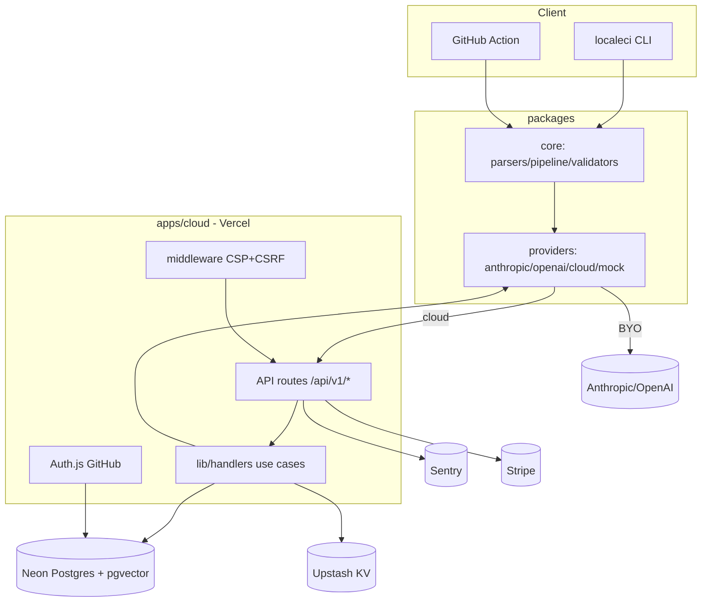
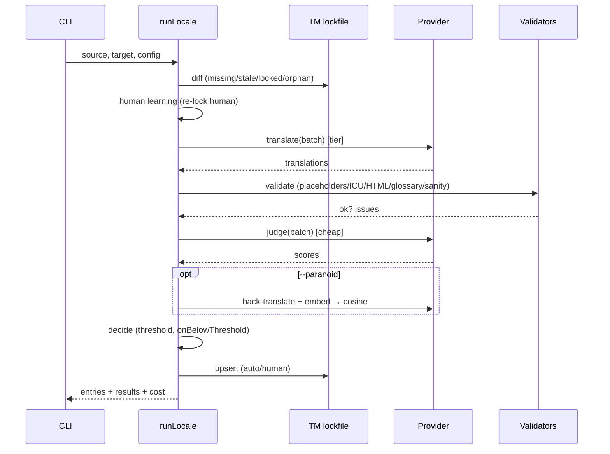

# 4. Arquitetura

> 📚 [Índice da documentação](./index.md)

## 4.1 Estilo & Justificativa
**Modular Monolith no núcleo (packages) + Serverless na cloud (Next.js/Vercel).**
- Núcleo é uma biblioteca pura (filesystem-free, network-free) com **portas &
  adaptadores (Hexagonal)**: `Parser` e `Provider` são as portas; JSON/YAML/PO/…
  e Anthropic/OpenAI/mock/cloud são adaptadores. Facilita testes (mock) e extensão.
- Cloud é serverless por custo (escala a zero) e simplicidade operacional (sem
  K8s). Rotas Next são **adaptadores finos** sobre *handlers* injetáveis testados
  (Clean Architecture: caso-de-uso no `lib/`, I/O na borda).
- **Event/Job-driven** apenas onde necessário (fila de tradução sob carga).

## 4.2 Padrões aplicados
| Padrão | Onde |
|---|---|
| Hexagonal (Ports & Adapters) | `Parser`, `Provider`, `SemanticMemory`, `Cache`, `RateLimiter`, `AuditLog`, `MembershipStore` |
| Clean Architecture | `lib/handlers/*` (casos de uso) ↔ rotas (borda) ↔ `server/*` (infra) |
| DDD (tático leve) | Entidades: Org, User, ApiKey, UsageEvent, Review, Invite, Job, AuditEvent |
| CQRS (leve) | Leituras de dashboard/usage → read replica; escritas → primary |
| Strategy | Roteamento de modelos (tier), escolha de provider |
| Pipeline | `parse→diff→context→batch→translate→validate→judge→score→decide` |
| Circuit Breaker | Budget cap de custo LLM (playground/org) |

## 4.3 Diagrama de containers (C4 nível 2)

## 4.4 Fluxo do pipeline de tradução (sequência)

## 4.5 Decisões-chave (ADR resumido)
- **TM como lockfile** (não banco): dados do cliente, versionado, idempotente.
- **Zero-retention por padrão** no proxy: privacidade na origem.
- **Serverless (sem K8s)**: custo e simplicidade; equivalentes gerenciados.
- **Portas & adaptadores**: testabilidade (mock) e extensibilidade (formatos/providers).

---
[← Requisitos](./requirements.md) · [Índice](./index.md) · [Modelo de Dados →](./data-model.md)
