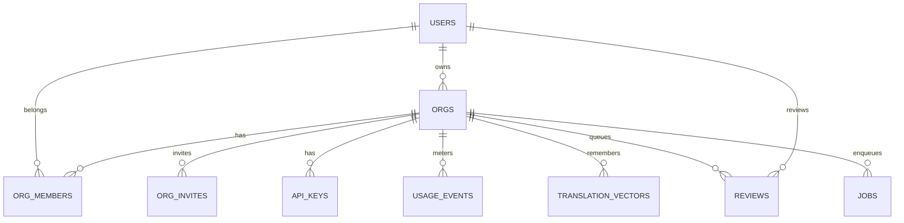

# 5 & 7. Modelo de Dados e Banco

> 📚 [Índice da documentação](./index.md)

## 5.1 Modelo conceitual (MER)

## 5.2 Modelo lógico/físico (Drizzle → Postgres)
| Tabela | Campos-chave | Tipos | Índices | Constraints |
|---|---|---|---|---|
| `users` | id(PK), github_id(UQ), email, name, mfa_secret, mfa_enabled_at, created_at | text/timestamp | uq(github_id) | NOT NULL id/github_id/email |
| `orgs` | id(PK), name, owner_id(FK users), plan(enum), stripe_customer_id, stripe_sub_id | text/enum | — | FK owner_id |
| `org_members` | id(PK), org_id(FK), user_id(FK), role(enum) | text/enum | uq(org_id,user_id) | RBAC |
| `org_invites` | id(PK), org_id(FK), email, role, token(UQ), status(enum), expires_at | text/timestamp | idx(org_id,email) | uq(token) |
| `api_keys` | id(PK), org_id(FK), hash, prefix, last_used_at, revoked_at | text/timestamp | idx(prefix) | hash argon2/scrypt |
| `usage_events` | id(PK), org_id(FK), period, strings_translated, tokens_in/out, model, locale, content_hash? | text/int/bigint | idx(org_id,period) | **sem coluna de texto** (zero-retention) |
| `translation_vectors` | id(PK), org_id(FK), locale, source, target, embedding(vector 1536) | vector | uq(org,locale,source), hnsw(vector_cosine_ops) | pgvector |
| `reviews` | id(PK), org_id(FK), batch, key, locale, source, machine_target, score, status(enum), final_target, reviewer_id | text/enum | idx(org,batch,status) | — |
| `jobs` | id(PK), org_id?, kind, payload(jsonb), status(enum), attempts, max_attempts, next_run_at, lease_until | jsonb/timestamp | idx(status,next_run_at) | FOR UPDATE SKIP LOCKED |
| `audit_log` | seq(PK), actor_id, org_id, action, target, at, meta(jsonb), prev_hash, hash | text/jsonb | idx(org_id,seq) | **imutável, hash-chained** |

## 5.3 Views / Procedures / Triggers
O design é *application-driven* (Drizzle); não há triggers/procedures — a
integridade da cadeia de auditoria é garantida no `DbAuditLog` (transação + lock
da tail).
- **View sugerida:** `org_usage_current` (agregação de `usage_events` por
  org/período) para o dashboard.
- **Trigger sugerida (opcional):** `audit_log` `BEFORE UPDATE/DELETE → RAISE`
  para reforçar imutabilidade no nível do banco.

## 7. Banco de Dados
- **Engine:** PostgreSQL (Neon serverless) + extensão `vector` (pgvector).
- **ORM/migrations:** Drizzle + drizzle-kit (`pnpm db:generate` → SQL versionado
  em `drizzle/`; `pnpm db:migrate`). **Estratégia:** migrations forward-only,
  revisadas em PR; `CREATE EXTENSION vector` uma vez.
- **Chaves:** PKs textuais cuid2; FKs explícitas; UQs em (org,locale,source),
  (org,user), github_id, token, prefix (índice).
- **Retenção:** usage 400d, reviews 180d, audit 730d, TM do cliente = ilimitada.
- **Read scaling:** `dbRead` (replica) para leituras de dashboard/usage.

---
[← Arquitetura](./architecture.md) · [Índice](./index.md) · [APIs →](./api.md)
