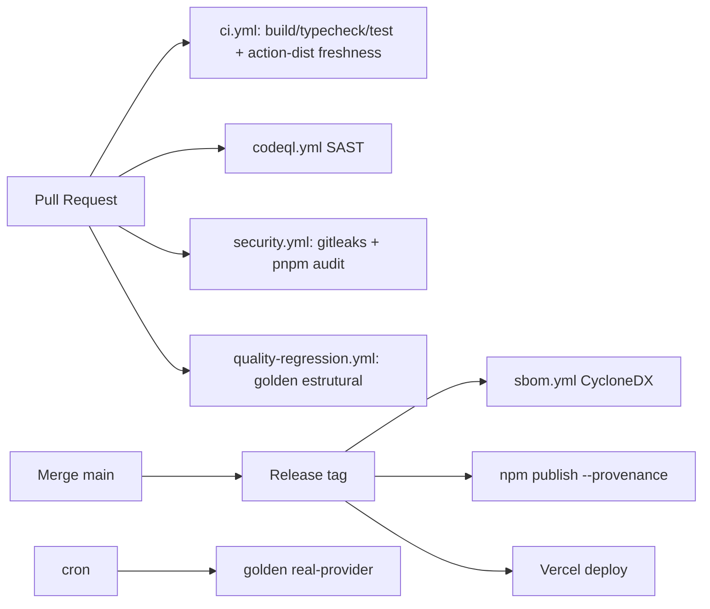

# 11. DevOps

> 📚 [Índice da documentação](./index.md)

## 11.1 CI/CD

Workflows em `.github/workflows/`: `ci.yml`, `codeql.yml`, `security.yml`,
`quality-regression.yml`, `sbom.yml`.

## 11.2 Git Flow & Branches
- Trunk-based: `main` protegida; branches `feat/*`, `fix/*`, `docs/*`; PR com CI
  verde + CODEOWNERS; squash-merge.

## 11.3 Testes automáticos
- 314 testes (Vitest) offline (mock); golden regression; SCA gate.

## 11.4 Deploy / Rollback / Flags / Blue-Green / Canary
- **Deploy:** Vercel (preview por PR, prod no merge).
- **Rollback:** promover deployment anterior (imutável) na Vercel.
- **Feature flags:** via env/plano (`org.plan`, `context.ast`, `quality.paranoid`).
- **Canary/Blue-Green:** Vercel traffic split (recomendado para mudanças de
  prompt/modelo, junto do golden set).

---
[← Infraestrutura](./infrastructure.md) · [Índice](./index.md) · [Segurança →](./security.md)
