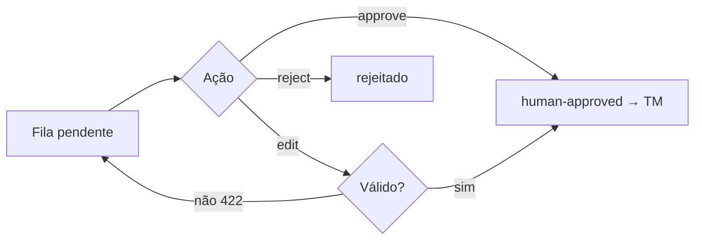

# 8. Front-end

> 📚 [Índice da documentação](./index.md)
>
> A UI web é uma **implementação de referência** (Next.js App Router). A
> experiência principal do produto é a **CLI** (madura). Para produção,
> recomenda-se adotar um Design System (ver [Melhorias](./improvements.md)).

## 8.1 Telas
| Tela | Rota | Componentes | Estados |
|---|---|---|---|
| Landing | `/` | hero, código, pricing, FAQ | — |
| Dashboard | `/dashboard` | uso do mês, barra de cota, gerar key, upgrade | loading/empty/erro |
| Preview visual | `/dashboard/preview` | cards fit/tight/overflow por elemento | — |
| Review queue | `/dashboard/reviews` | lista + approve/edit/reject | vazio 🎉 |
| Playground | `/playground` | textarea, seletor locale, resultado+score | loading, throttled(429) |

## 8.2 UX/UI/Acessibilidade (estado atual & metas)
- **CLI (nota alta):** `init` mágico, cores por score, exit codes, `--json`, `--mock`.
- **Web (a evoluir):** hoje usa estilos inline sem Design System, responsividade
  mínima e **acessibilidade insuficiente** (faltam labels/aria, foco visível,
  verificação de contraste). **Meta:** WCAG 2.1 AA, tokens, dark/light.
- **Mensagens/validações:** erros de config apontam o campo (Zod); no web,
  formulários devem exibir erros inline + toasts.

## 8.3 Fluxo de review (web)

## 8.4 Design System (proposta)
Tokens (cor/tipografia/espaçamento), componentes acessíveis (Button, Input,
Table, Card, Toast), tema claro/escuro, responsividade mobile-first, verificação
`axe` no CI.

---
[← APIs](./api.md) · [Índice](./index.md) · [Backend →](./backend.md)
