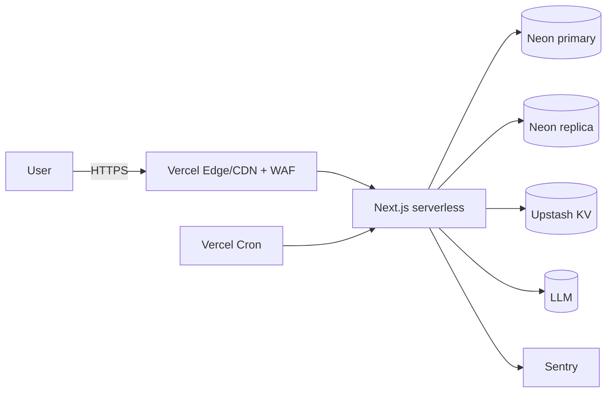

# 10. Infraestrutura

> 📚 [Índice da documentação](./index.md) · Deploy: [deploy.md](./deploy.md)

| Item | Escolha | Notas |
|---|---|---|
| Cloud | **Vercel** (app + cron) | serverless, escala a zero |
| Banco | **Neon** Postgres + pgvector | branch/PITR; read replica |
| KV/Cache | **Upstash** Redis | rate limit + TM cache distribuídos |
| Erros | **Sentry** | com redaction (sem conteúdo do cliente) |
| Email | **Resend** | transacional (convites) |
| Pagamentos | **Stripe** Checkout + Portal | PCI SAQ-A |
| Containers/K8s | **N/A** | serverless por escolha; equivalentes: edge config, secrets Vercel |
| CDN | Vercel Edge (default) | + CDN para assets estáticos |
| Storage | — | sem blobs; strings ficam no Git do cliente |
| Secrets | Vercel Env Vars | rotação manual; futura: vault |
| IAM/Rede/DNS | Vercel/Neon gerenciados | DNS do domínio; TLS gerenciado |
| Firewall/WAF | Vercel + rate limit app-layer | WAF gerenciado (Vercel) |
| IaC | **Ausente** (gap) | recomendação: Terraform (ver [Melhorias](./improvements.md)) |

## Variáveis de ambiente
Consolidadas em [`apps/cloud/.env.production.example`](../apps/cloud/.env.production.example)
(app, DB primário/replica, Auth GitHub, chaves LLM, KV, Sentry, guardrails de
rate/budget, WORKER_SECRET, Stripe, Resend).

---
[← Backend](./backend.md) · [Índice](./index.md) · [DevOps →](./devops.md)
