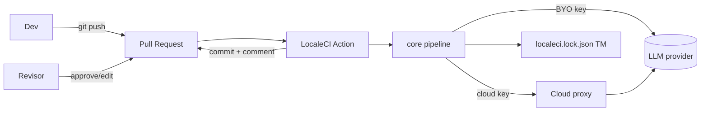

# 1. Visão Geral

> 📚 [Índice da documentação](./index.md)

## 1.1 Objetivo do sistema
LocaleCI é uma plataforma **Git-native** de localização (i18n) que traduz os
arquivos de mensagens de um app com LLMs **a cada commit**, atribuindo a **cada
string um score de qualidade auditável (0–100)**. O produto é o *pipeline de
qualidade*, não a tradução em si.

## 1.2 Problema resolvido
Times de SaaS pequenos/médios não localizam porque as opções são ruins:
- **TMS** (Lokalise/Crowdin/Phrase): US$ 120–1.200/mês, semanas de setup, strings
  na plataforma de terceiros, workflow feito para tradutores, não para CI.
- **Script GPT caseiro**: quebra plurais ICU, perde placeholders, sem memória de
  tradução, sem glossário, ninguém confia em produção.

LocaleCI é a terceira opção: **tradução como build step** — Git é a fonte da
verdade, cada string recebe um score verificável, e a revisão acontece no PR.

## 1.3 Público-alvo & Personas
| Persona | Papel | Dores | Como o produto ajuda |
|---|---|---|---|
| **Dev full-stack (indie/SaaS)** | Instala e mantém i18n | Não quer TMS caro nem script frágil | `npx localeci`, Action no PR, custo próximo de zero |
| **Tech Lead** | Aprova qualidade | Não confia em tradução por IA | Score por string + validadores determinísticos + review no PR |
| **Product/Growth** | Quer novos mercados | 60–75% do TAM fala outra língua | Localização barata e rápida |
| **Revisor/Tradutor** | Corrige flagged | Contexto ausente | Contexto do componente + review colaborativo web |
| **Org Admin (cloud)** | Gerencia time/billing | RBAC, cotas, compliance | Membros/RBAC, planos, DSAR, audit log |

## 1.4 Benefícios & Diferenciais
- **Diff mínimo (regra de ouro):** serializers preservam ordem/indentação/
  comentários — o PR só mostra as strings novas/alteradas.
- **Validadores determinísticos** (placeholders, ICU/CLDR, HTML, glossário,
  sanidade) rodam *antes* do LLM-judge — quebra estrutural nunca chega ao repo.
- **Translation Memory como lockfile** versionado no Git → idempotente, $0 no
  caso comum, dados do cliente (anti-lock-in).
- **10 formatos**, **contexto por AST** (React/Vue/Svelte), **back-translation por
  embeddings**, **retrieval semântico (pgvector)**, **aprendizado humano**.

## 1.5 Casos de uso
UC-01 Onboarding (`init`) · UC-02 Traduzir faltantes (`translate`) · UC-03
Validar em CI (`check`) · UC-04 Cobertura (`status`) · UC-05 Traduzir no PR
(Action) · UC-06 Revisar no PR/web · UC-07 Proxy metered (cloud) · UC-08
Playground · UC-09 DSAR/exclusão · UC-10 Export de dataset fine-tuning.

---
[← Índice](./index.md) · [Requisitos →](./requirements.md)
